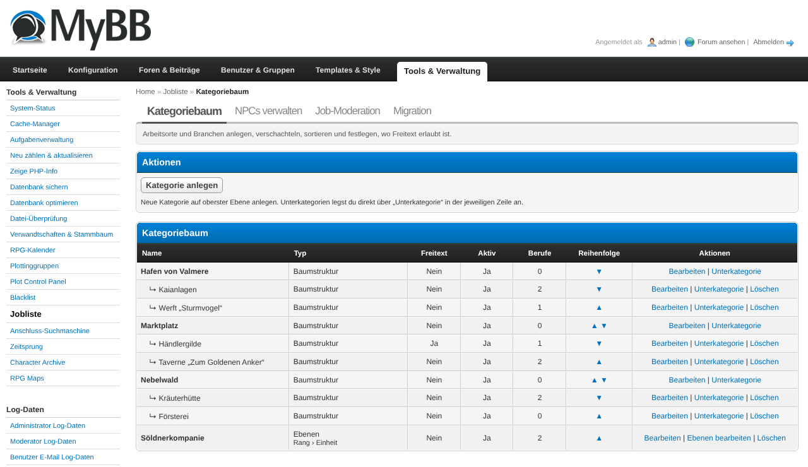
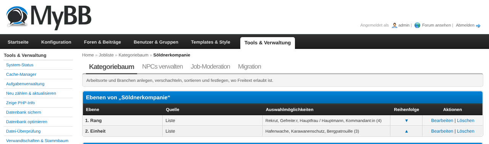
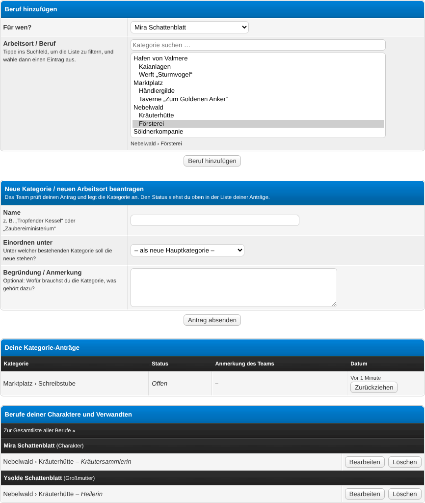
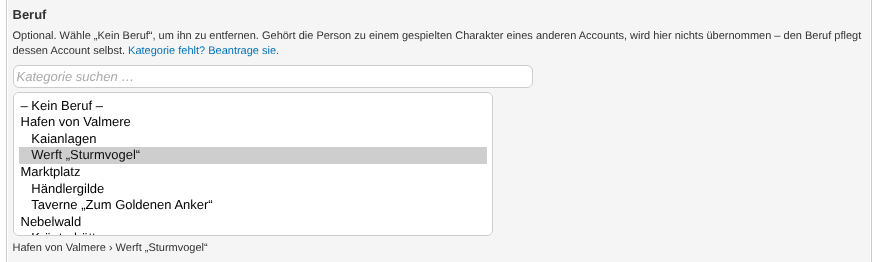
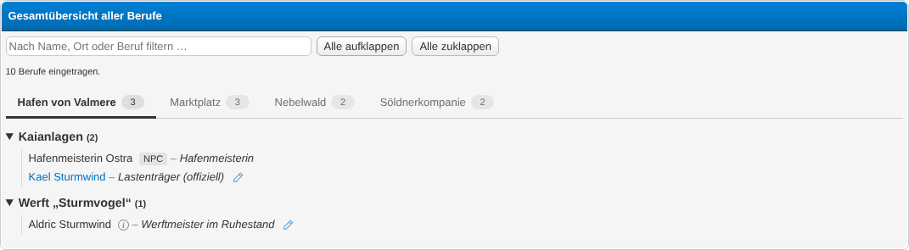
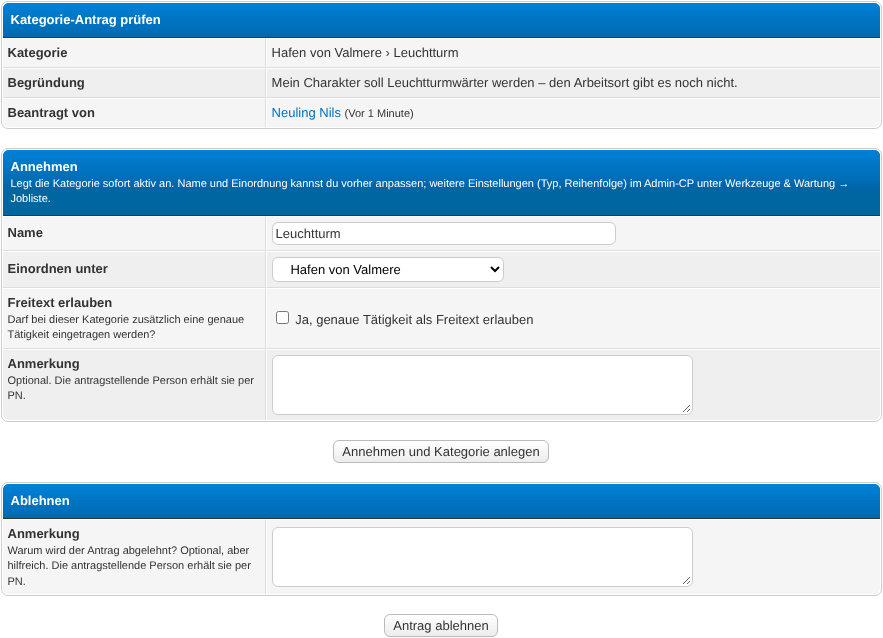

# Jobliste – Job List

A MyBB 1.8 plugin for character-based roleplay forums. Members record the jobs and workplaces
of their characters – and, optionally, of their characters' relatives – by picking from a
category tree that the team maintains in the ACP (places, businesses, sectors). Team members can
also add jobs for NPCs. Everything comes together in a collapsible, searchable overview of all
jobs, grouped by category, so players can see at a glance who works where.

Built for RPG forums where "who works at the Three Broomsticks?" should be answerable without
scrolling through one huge nested table.

## Requirements

- MyBB 1.8.x
- PHP 7.4 or 8.x
- MySQL 5.7+ / MariaDB 10.2+ (InnoDB)
- **No dependencies.** Optional integration: the *Relatives & Family Tree* plugin
  (`relatives`) – with it, members can also add jobs for the relatives of their characters,
  and Relatives shows each person's job in its family tree, relatives list and profile cards.
  The job can also be set directly in Relatives' person form.
  Without it, the plugin works completely on its own (own character + NPCs).

## Installation

1. Upload the contents of this repository into your MyBB root directory. The folders `admin/`
   and `inc/` merge with the existing ones, `jobliste.php` goes next to `index.php`.
2. **ACP → Configuration → Plugins** → *Jobliste* → **Install & Activate**.
3. **ACP → Configuration → Settings → Jobliste** → review the settings (see
   [Configuration](#configuration)). At least check **Team groups**.
4. **ACP → Tools & Maintenance → Job List → Category tree** → create your categories (see
   [Managing the category tree](#managing-the-category-tree)). Members cannot add jobs until
   at least one active category exists.

Activation adds the following to your templates automatically (and removes it again on
deactivation):

- a **Jobs** entry in the *Miscellaneous* box of the User CP navigation (`usercp_nav_misc`),
- `{$jobliste_request_notice}` right after `{$header}` in the `index` template (red notice for
  the team about open category requests),
- `{$jobliste_modcp_nav}` at the end of the ModCP navigation (`modcp_nav`).

If your theme uses heavily customised versions of these templates and an entry does not show
up, add the variable manually at the desired position.

**Updating to a newer version:** upload the new files, then **ACP → Configuration → Plugins** →
*Jobliste* → **Deactivate** and **Activate** again. This refreshes the templates and the
stylesheet (e.g. new templates for the job field in the Relatives person form and the
stylesheet attachment to `relatives.php`). Settings and data are kept.

Upgrading from the legacy job plugin (v1.x, *h4w-multiple-berufe* / *jobs*)? Follow
[Migrating from the legacy plugin](#migrating-from-the-legacy-plugin) before your members
start adding jobs.

## Usage

### First steps after activation

1. **ACP → Configuration → Settings → Jobliste → Team groups**: choose the groups that count as
   team. Team members may add jobs for NPCs, edit/delete other members' jobs and – if they also
   have ModCP access – handle category requests.
2. **ACP → Tools & Maintenance → Job List → Category tree**: build the category tree.
3. Optionally create NPCs under **ACP → Tools & Maintenance → Job List → Manage NPCs** (team
   members can also do this in the frontend).
4. Tell your members where to find it: **User CP → Miscellaneous → Jobs**. The overview of all
   jobs is at `jobliste.php?action=overview` – link it wherever your other lists live.

### Managing the category tree

**ACP → Tools & Maintenance → Job List → Category tree**

- **Add category** creates a new category. Fields:
  - **Name** – shown in the selection and the overview.
  - **Parent category** – where the category sits in the tree; *top level* creates a root
    category. Every root category becomes its own tab in the overview (e.g. *GB*, *not GB*,
    *Muggles*).
  - **Type** – *Tree* (you create all sub-categories by hand) or *Levels* (see below).
  - **Free text allowed** – members may add their own job title (e.g. "Secretary") when they
    pick this category.
  - **Active** – inactive categories (and everything below) can no longer be selected. Existing
    jobs keep them; empty inactive branches are hidden in the overview.
- In the list, each row offers **Edit**, **Sub-category** (adds a child), **Delete** (only for
  categories without sub-categories) and ▲/▼ to change the order among siblings.
- Deleting a category moves its jobs to the parent category. Jobs of a deleted root category
  get the old category name as free text (if they have none yet), so nothing gets lost.

### Category type "Levels"

For big areas such as "not GB" or "Muggles" you don't want to create one sub-category per
country and sector. Set the category's **Type** to *Levels* and define an ordered list of
levels instead:

1. **ACP → Tools & Maintenance → Job List → Category tree** → **Edit levels** in the row of
   the category (after saving a new *Levels* category you are taken there directly).
2. Per level:
   - **Label** – e.g. "Country", "Sector".
   - **Source** – *Profile field*: the options of an existing selection profile field
     (select, radio, multi-select, checkbox), e.g. your "Origin" field; or *List*: values you
     maintain right here, one per line.
3. When adding a job in this category, members pick one value per level. The job is shown as
   "Muggles › GB › Other – Army doctor", and the overview groups the entries dynamically by the
   values that are actually in use.

A *Levels* category cannot have manual sub-categories. Values that later disappear from the
profile field or list stay on existing jobs and remain selectable when editing them.

### For members: adding jobs

**User CP → Miscellaneous → Jobs**

1. **Add job**:
   - **For** – your own character or, with the Relatives plugin, one of the relatives you
     created there.
   - **Category** – type into the search box to filter the tree, then pick the category.
   - **Levels** – only for *Levels* categories: one value per level.
   - **Job title (free text)** – only if the category allows it.
2. Below the form you find your own jobs and those of your relatives, each with **Edit** and
   **Delete**. Relatives without jobs are not listed; they stay selectable in the form.
3. **Go to the list of all jobs** opens the overview.

If the administrator set a maximum number of jobs per person, a note above the form shows it.

### With the Relatives plugin: job in the person form

Prerequisite: the *Relatives & Family Tree* plugin is active, the setting *Relatives
integration* is on and at least one category exists.

**Relatives → add or edit a person** (the form of the Relatives plugin): between *Origin* and
*Mark as wanted* there is a **Job** field.

1. **Category** – same searchable field as in the job list. Pick **– No job –** to remove the
   job (or to add none).
2. **Levels** / **Job title (free text)** – appear when the chosen category needs or allows
   them.
3. Save the person – the job is saved with it. Errors (e.g. a missing level) stop saving and
   are shown by Relatives.

Who gets the job:
- **Played characters** (person confirmed as linked to an account): the job belongs to the
  account – it is the same job as in the job list. Only the account itself (or the team) can
  change it; everyone else only sees it.
- **All other persons**: the job belongs to the person as a relative, editable by everyone who
  may manage the person in the job list (owners, team).

Several jobs: the form edits only the **first** (oldest) job; a note shows how many further jobs
exist – manage those in the job list. Jobs without a category (legacy data) are shown read-only
there. When you add a person that already exists (Relatives joins you to it), an existing job
is never overwritten; a job is only added if the person has none yet. The quick form in the
family tree does not change jobs.

### The overview of all jobs

`jobliste.php?action=overview` – a standalone list page (optionally for guests).

- One tab per root category; without JavaScript all areas are shown one below the other.
- Collapsible categories with the number of jobs, **Expand all** / **Collapse all**.
- The search filter searches all tabs (names, job titles, who added a relative); tabs without
  hits are dimmed. The selected tab is kept in the URL (`#jobliste-<id>`), so you can link to it.
- Accounts are linked to their profile in their group colour, NPCs get an *NPC* badge.
  Relatives get an info icon: hover, focus or click shows who added the person and in which
  degree.
- Relatives that are confirmed as linked to a character account appear as that account. If the
  account has jobs of its own, only those count and the relative's jobs are hidden.
- Members see a pencil icon (**Edit**) at their own entries, the team at all entries.

The page can be embedded into the frame of your forum's other lists (see the settings
*Overview: frame template* and *Overview: navigation template*).

### Requesting new categories

If a workplace is missing, members don't have to write to the team:

1. **User CP → Miscellaneous → Jobs** → section **Request a new category / workplace**: enter a
   name, choose where it belongs (or *as a new top-level category*) and give a short reason.
2. The own requests are listed below with status and the team's note; open requests can be
   withdrawn.
3. Limits: at most 5 open requests per member; no request for a category that already exists or
   has already been requested at the same place (case-insensitive).

### For the team: handling requests (ModCP)

Team members with ModCP access see a red notice on the forum index while requests are open.

1. **ModCP → Job List → Category requests** lists open and recently handled requests.
2. **Review** a request:
   - **Approve** – name, parent category and "free text allowed" can be adjusted before the
     category is created (active).
   - **Reject** – with an optional reason for the member.
3. With the setting *PM on decision* the member is informed by PM (sender: the team member
   who handled the request). The PM is sent like a normal PM, so MyAlerts and the Account
   Switcher react to it.

### For the team: NPCs

- **Frontend:** **User CP → Miscellaneous → Jobs → Manage NPCs** (link next to the overview
  link). Create, edit and delete NPCs; **+ Add job** jumps to the form with the NPC
  preselected.
- **ACP:** **ACP → Tools & Maintenance → Job List → Manage NPCs** – same functions for
  administrators. The job is picked right in the NPC form (searchable category, levels and
  free text like in the frontend). **Edit** shows all jobs of the NPC for editing plus a field
  for another job; choosing *– no job –* removes a job when saving.
- Deleting an NPC also deletes its jobs.

### For administrators: job moderation

**ACP → Tools & Maintenance → Job List → Job moderation** lists all jobs with filters for type
(account / relative / NPC), category and free-text search (job title and level values). Every
entry can be deleted from here.

### Migrating from the legacy plugin

**ACP → Tools & Maintenance → Job List → Migration**

Prerequisite: if the legacy tables `relatives` / `wanted` exist, the *Relatives & Family Tree*
plugin must already be installed **and migrated** – relatives' jobs are matched via its
migrated persons. Otherwise the migration stops with a message instead of importing half of
the data.

1. Check the status table: which legacy tables were found, when the migration last ran.
2. **Profile field for the level "Country"** – for legacy "not GB" / "Muggles" entries
   (format *root › country › sector › job*) the migration switches those root categories to the
   type *Levels*. Choose the profile field that holds the characters' origin (preselected if a
   field with "Herkunft"/"origin" in its name exists) or *no profile field* to build a list from
   the legacy data.
3. **Run migration**. The report shows imported categories and jobs, skipped entries and legacy
   references that could not be resolved (for manual checking).
4. A second run is blocked; with **Run again (force)** only missing entries are added, nothing
   is duplicated.

### Tips & Tricks

- **Categories missing in the selection?** Check that the category *and all of its parents* are
  active.
- **Relatives integration off** (setting): relatives' jobs stay in the database but are neither
  listed in the frontend nor selectable. The ACP moderation still shows them.
- **Relatives plugin deactivated** while the integration is on: relatives' jobs are hidden in
  the overview until the plugin is active again; the ACP moderation shows them as
  "Relative (not found)".
- **Relatives deleted a person** (e.g. when the last account that added them was deleted):
  the job is no longer shown in the overview. **ACP → Tools & Maintenance → Job List → Job
  moderation** then shows a notice with **Delete orphaned jobs** to remove such jobs for good.
  The notice only appears while the Relatives plugin is active – an inactive plugin never
  makes jobs count as orphaned. Important persons that should outlive their characters belong
  in the NPC list.
- **Deleted accounts:** their own jobs and category requests are removed automatically; jobs
  and NPCs they created as team members stay.

## Configuration

**ACP → Configuration → Settings → Jobliste** (the setting titles are shown in German in the
ACP; the German title is given in brackets)

- **Jobliste active** *(Jobliste aktiv)* – master switch. Off: `jobliste.php` only shows a notice.
- **Team groups** *(Team-Gruppen)* – members of these groups may add jobs for NPCs and edit/delete other
  members' jobs. With ModCP access they also handle category requests. Empty = nobody.
- **Relatives integration** *(Verwandten-Integration)* – allow jobs for relatives (Relatives plugin). Off = relatives are
  ignored, even if the Relatives plugin is active.
- **Maximum jobs per person** *(Maximale Berufe pro Person)* – abuse protection per character, relative or NPC. 0 = unlimited.
- **Last legacy migration** *(Letzte Legacy-Migration)* – set automatically by the migration tool. Don't change it by hand.
- **Overview for guests** *(Gesamtliste für Gäste)* – may guests see the overview of all jobs? The group permission
  "Can view board" applies in addition.
- **Overview: frame template** *(Gesamtliste: Rahmen-Template)* – name of an existing template the overview is
  embedded into, e.g. the frame of your other lists (`listen`). It receives the content as
  `{$listen_content}` / `{$jobliste_overview_content}`, the navigation as `{$listen_nav}` /
  `{$jobliste_list_nav}` and the title as `{$headline}`. Empty (or unknown template) = the
  plugin's own page.
- **Overview: navigation template** *(Gesamtliste: Navigations-Template)* – name of an existing template with the list
  navigation, e.g. `listen_nav`. Only used together with the frame template.
- **Category requests** *(Kategorie-Anträge)* – may members request new categories in the User CP?
- **PM on decision** *(PN bei Entscheidung)* – inform members by PM when their request is approved or rejected.

## For developers

Jobliste defines two provider hooks so other plugins can supply entities without Jobliste
knowing them (the *Relatives* plugin uses them):

- `jobliste_collect_entities` – `$args = ['uid' => int, 'entities' => [...]]`. Append rows
  `['entity_type' => 'relative', 'entity_id' => int, 'label' => string, 'relation_label' => string]`
  for the persons the user may manage.
- `jobliste_resolve_entity_label` – `$args = ['entity_type', 'entity_id', 'label' => null,
  'relations' => [], 'linked_uid' => 0]`. Set `label` (raw text); optionally `relations`
  (`[['uid' => int, 'relation_label' => string], ...]` – who added the person, in which degree)
  and `linked_uid` (confirmed linked character account).

Contract: providers deliver raw text – Jobliste escapes on output. Every row is validated
(type casts, allowed entity types, value ranges); malformed rows are silently discarded, so a
broken provider can never break the job list. With the setting *Relatives integration* off, the
hooks are not fired at all.

In the other direction, Jobliste **listens** to a hook of the *Relatives* plugin so that the
family tree panel, the "My relatives" list and the search cards in the profile can show each
person's job:

- `relatives_collect_person_details` – `$args = ['person_ids' => int[], 'linked_uids' =>
  [person_id => uid], 'details' => []]` (passed by reference). Jobliste sets
  `$args['details'][$person_id]['job']` (raw text, no HTML) for every person with a job.
  Played characters (confirmed linked, listed in `linked_uids`) get the jobs of their account
  (`entity_type = 'user'`), all other persons the jobs entered for them as a relative
  (`entity_type = 'relative'`). Several jobs are joined with `, ` (oldest first); the text is
  built like in the job list: category path › level values – free text. One query for all
  persons; only Jobliste's own tables are read. Malformed arguments are ignored silently; with
  *Relatives integration* off, nothing is provided.

For the person form, Jobliste listens to three more Relatives hooks. All get
`['person_id' => int (0 = new person), 'linked_uid' => int (0 = not a played character),
'uid' => int (editing account)]` plus the key named below. Mapping as above: `linked_uid > 0` →
`entity_type = 'user'` + `linked_uid`, otherwise `'relative'` + `person_id`.

- `relatives_person_form_fields` (+ `html`) – appends escaped HTML (no own `<form>`): hidden
  `jobliste_submitted=1`, `jobliste_person_id`, `jobliste_job_id` (edited job, 0 = none) and
  the fields `jobliste_category_id`, `jobliste_custom_label`, `jobliste_level[cat][i]`. Nothing
  without categories; read-only text if the account may not set the job.
- `relatives_person_validate` (+ `errors`) – only when `jobliste_submitted=1`. Empty choice is
  valid (= remove); otherwise the same rules as the job list form. Errors are appended as raw
  text. If the person turns out to be another account's played character (e.g. a new entry that
  Relatives merges into an existing person), the job input is ignored instead of blocking the
  save – that account maintains its own job.
- `relatives_person_saved` (+ `is_new`) – only when `jobliste_submitted=1`: delete / update the
  edited job, or add one if the entity has none yet. Permissions are checked again (the person
  may have been created just now).

All three require *Jobliste active* and *Relatives integration*; malformed arguments, or a `uid`
that is not the logged-in account, are ignored silently and the listeners never throw.

## Uninstallation

1. **ACP → Configuration → Plugins** → *Jobliste* → **Deactivate**. This removes the
   templates, the stylesheet and the template changes (User CP, index, ModCP navigation);
   settings and data stay.
2. **Uninstall** removes all tables (categories, levels, jobs, NPCs, requests) and all settings.
   This cannot be undone.
3. Delete the plugin files: `jobliste.php`, `inc/plugins/jobliste.php`, the folder
   `inc/plugins/jobliste/`, `admin/modules/tools/jobliste.php` and the language files
   `inc/languages/*/jobliste.lang.php` and `inc/languages/*/admin/jobliste.lang.php`.

## Changelog

See [CHANGELOG.md](CHANGELOG.md).
